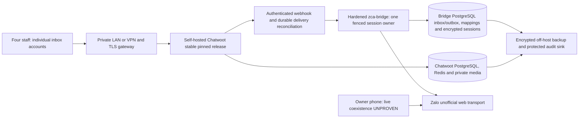

# Personal Zalo shared inbox: independent validation

Research date: **27 October 2026**. Target: **one personal Zalo account, four simultaneous staff workstations, one active owner phone**. Decision: **select a hardened diendh/zca-bridge + self-hosted Chatwoot as the best pilot foundation; accept none of the four unchanged for production.** This is a conditional architectural selection, not a demonstrated working five-device deployment.

The most consequential constraint is one shared backend Zalo Web listener. Four staff log into the inbox with separate application identities; they do not each log into Zalo Web or run an adapter. Phone coexistence is plausible in this architecture but **UNPROVEN** in this investigation. No account/phone was supplied or used. No evidence establishes ban safety.

## Scope and evidence quality

No HANU production account, real customer records, real cookies, or real Zalo messages were used. No public endpoint, application server, production deployment, upstream commit or repository change occurred. New evidence and selected source snapshots are confined to `/workspace/zalo-study`. No live QR was generated.

The environment reported current enforced unrestricted networking, but shell Git/npm connections to its configured local proxy failed. Public source was fetched successfully with the connected GitHub reader. Therefore **no full application/container deployment, dependency installation, database recovery drill or end-to-end browser test succeeded or is claimed**. The GitHub reader fallback provided pinned source for static review and executable source-level synthetic tests. Snapshots are partial except the standalone service's complete 41-blob snapshot. A partial snapshot is not a buildable checkout.

Definitions used throughout:

- **PASS (runtime):** observed behavior under the explicitly stated synthetic/adapted test boundary. Passing a defect-reproduction assertion does not mean the acceptance criterion passes.
- **FAIL:** required behavior missing in inspected source or contradicted in an executed synthetic test. Source findings are labeled; these are not unperformed penetration tests.
- **UNPROVEN:** not exercised, blocked, documentation-only, or dependent on real platform behavior. Absence of a test is not a demonstrated platform failure.

## Pinned comparison

| Candidate / audited revision | What it supplies | Licensing evidence | Dependency/test evidence | Assessment |
|---|---|---|---|---|
| [vuongnguyenbinh/ZaloCRM](https://github.com/vuongnguyenbinh/ZaloCRM/tree/d186fd2fd75f886a993e2de0b802e52675dac1f7) `d186fd2…` | Vue staff UI, Fastify/Socket.IO, Prisma/PostgreSQL, central Zalo pool | README MIT vs backend ISC; no LICENSE in complete tree: **ambiguous** | zca-js ^2.1.2; lockfiles present; no test/CI suite in tree; build/audit blocked; 3 synthetic defect checks reproduced | Complete-looking workflow, but critical socket disclosure and broad member account-control routes make it a poor starting security posture |
| [diendh/zca-bridge](https://github.com/diendh/zca-bridge/tree/1d7fd5946711ab44ef4427561c872ae0ae7e2248) `1d7fd59…` + Chatwoot | Personal adapter, encrypted sessions, PostgreSQL queue/mappings, reconnect supervisor; Chatwoot provides staff inbox | Bridge Apache-2.0; Chatwoot core MIT, enterprise separately licensed | zca-js **2.1.2 exact**, Node >=24, pg/Fastify/sharp; tests declared (Vitest); full suite/build blocked; synthetic route/auth/crypto checks executed | **Best pilot foundation**, conditional on authentication and delivery repairs; mature inbox architecture reduces custom staff UI work |
| [leanhluong/zca-zalo-service](https://github.com/leanhluong/zca-zalo-service/tree/5f3f66f722aaa29e877a258c218de9ae6759df39) `5f3f66f…` | Express HTTP adapter, events/media normalization, upstream callbacks/session restore; no staff inbox or local DB | No LICENSE or license field in complete tree: **permission unresolved** | zca-js range ^2.0.0 resolves **2.1.2**; Express 4.22.1; **46/46 adapted upstream unit assertions pass** plus synthetic failure POC | Useful normalization code; upstream would need to supply security, storage, delivery and all staff workflow |
| [RFS-ADRENO/zca-js](https://github.com/RFS-ADRENO/zca-js/tree/0586dc5e4981985c5f16b9b3a5f285a02feb6f9b) `0586dc5…` | Unofficial browser-emulating SDK; no HTTP inbox/staff/storage layer | MIT | Version **2.2.0**, Node >=18; npm lock v3/266 records; CI build/lint and account-dependent examples; 6 synthetic listener checks executed | Transport building block, **not a solution for four staff on its own**; substantial application engineering required |

Chatwoot source independently inspected at develop revision [`90ed589c695f6aeaeea0e78f6be7d4ec0fb3e1b3`](https://github.com/chatwoot/chatwoot/tree/90ed589c695f6aeaeea0e78f6be7d4ec0fb3e1b3), specifically license and webhook producer/retry code. This is **not a pinned, deployed stable Chatwoot release** or a full Chatwoot security audit. Choose a supported stable release and verify behavior again before integration. The root SDK tests at 2.2.0 **do not prove defects or fixes in the bridges' locked 2.1.2 dependency**.

No candidate received an executed CVE audit, verified full build, complete SBOM or transitive license audit. Lockfile inventory and integrity fields establish reproducibility inputs, not vulnerability clearance. Do not call any candidate secure, maintained enough, or production ready merely because it has stars, recent commits or test scripts.

## Acceptance evidence matrix

`R` = executed source-level/adapted runtime; `S` = inspected source; `U` = unexecuted integration requirement. See linked detailed reports for pinned file and line references.

| Required behavior | ZaloCRM | Bridge + Chatwoot | zca-zalo-service | zca-js alone |
|---|---|---|---|---|
| Four authenticated concurrent staff workstations | **UNPROVEN U**; users/ACL/UI exist S | **UNPROVEN U**; individual Chatwoot users are architectural fit S | **FAIL S** as standalone: no staff UI/model | **FAIL S** as standalone: SDK only |
| Simultaneous owner phone operation | **UNPROVEN U** | **UNPROVEN U**; self/native message mapping exists S | **UNPROVEN U**; selfListen enabled S | **UNPROVEN U**; selfListen default false S |
| Actual text/1:1/group delivery | **UNPROVEN U** | **UNPROVEN U** | **UNPROVEN U** | **UNPROVEN U** |
| Actual image/file/audio/video delivery | **UNPROVEN U** | **UNPROVEN U**; partial-attachment recovery defect S | **UNPROVEN U**; media/parser unit cases pass R | **UNPROVEN U**; v2 requires image metadata callback for file-path images/GIFs S |
| Live invalidation/new web session/re-QR | **UNPROVEN U** | **UNPROVEN U** | **UNPROVEN U** | **UNPROVEN U**; duplicate command closes listener **PASS R**, simulated only |
| Reconnect with complete gap recovery | **UNPROVEN U**; overlapping SDK/pool retry mechanisms S | **UNPROVEN U**; supervisor exists S | **FAIL R** autonomous healer rescheduling after one failed attempt; actual recovery U | Opt-in reconnect **PASS R**; default-off and stop cancellation criteria **FAIL R**; actual recovery U |
| Incoming duplicate suppression | **FAIL R** same ID creates 2 rows/unread twice | Queue uniqueness **PASS S**; external-create/map crash gap **FAIL S**; restart/concurrent DB test U | **FAIL R** same ID forwarded twice; expects upstream dedup S | **FAIL R** same ID emitted twice |
| Outgoing retry/idempotency | **FAIL S** send then DB insert; self-echo unreconciled | **FAIL R** disconnected job marked done unsent; retry after attachment 2 failure skips it; send/map crash gap **FAIL S** | **FAIL S** no request-key ledger; timeout does not cancel send | **FAIL S** no durable outbox supplied |
| Access controls protect session and messages | **FAIL R/S** unauth room joins/global emits; member account deletion/reconnect; stale JWT roles | **FAIL R/S** unsigned webhook accepted by default, Secure cookie absent; private gateway/HMAC required | **FAIL S** unauth session/send/delete API; base64 credentials | **FAIL S** standalone has no staff control layer |
| Complete staff/security audit | **FAIL S** ActivityLog schema without writes in inspected core paths | **FAIL S** operational logs capped/pruned, not immutable audit; CE audit limitations | **FAIL S** no staff identities/audit | **FAIL S** host application responsibility |
| Data persistence and restore | PostgreSQL/backups exist **PASS S**; durability/restore **UNPROVEN U** | Durable PostgreSQL queue exists **PASS S**; DB/media restore **UNPROVEN U** | **FAIL S** local state in memory, one-shot webhook; upstream persistence **UNPROVEN U** | **FAIL S** no business persistence; external implementation required |

These rows intentionally do not present mock callbacks as four workstations, a normalized image payload as media delivery, or a database schema as a successful restore.

## Findings that determine the recommendation

**ZaloCRM:** unauthenticated Socket.IO connections can choose organization/account rooms, and message paths broadcast with `io.emit`. Source-executed mocks confirmed arbitrary joins. JWT/org membership permits account management without account/admin permission; account deletion cascades message history. Session secrets are plaintext JSON, production JWT configuration has a public fallback, and seven-day JWT authorization does not recheck current active status/role. Deduplication and atomic send/storage are absent. This is deeper remediation than adding a private reverse proxy. [Detailed evidence](crm-findings.md).

**Bridge + Chatwoot:** the persistent queue, mappings, encrypted sessions and reconnect supervisor make the strongest architectural base, but they do not provide exactly-once external delivery. Missing session currently causes a note followed by successful return/drop. Sending before mapping creates a duplicate window on crash. Mapping an entire multi-attachment message after its first attachment can suppress later attachments on retry. Webhook URL secret is optional; the bridge ignores available Chatwoot signature headers. The bridge's comment that HTTP 500 makes Chatwoot retry is unsupported by the inspected Chatwoot API-inbox trigger, which catches errors without that retry path. Build a reconciliation/delivery mechanism rather than relying on this comment. [Detailed evidence](bridge-findings.md).

**Standalone service:** 46 useful upstream unit assertions passed when adapted to Node24 type stripping. They do not cover authentication or end-to-end reliability. Inbound forwarding is fire-and-forget without durable retry; duplicate IDs forward again. `cookiesEncrypted` is base64, not encryption. The API lacks inbound authentication, and arbitrary media URLs have insufficient fetch/resource boundaries. A failed healer does not self-schedule its next attempt; `wsAlive` is set before a connected event. These gaps and missing license make it a weaker foundation for this goal. [Detailed evidence](service-findings.md).

**zca-js:** its README explicitly says only one web listener can run per account. The executed listener accepts duplicate messages; reconnect is opt-in; stop during retry does not cancel the scheduled reconnect. [Unmerged PR 387](https://github.com/RFS-ADRENO/zca-js/pull/387) independently describes the latter defect; it was not treated as a released fix. The library is useful underlying transport, not a competitor to a complete inbox. [Detailed evidence](core-findings.md).

## Risk register

Likelihood ratings are engineering judgments, not measured probabilities. No numeric account-ban rate is defensible from this evidence.

| Risk | Severity / exposure | Evidence and required treatment | Residual / owner |
|---|---|---|---|
| Platform terms violation, account restriction/ban affecting phone too | Critical; inherent to all unofficial personal-account adapters | Official [Zalo terms §4.7](https://zalo.vn/dieukhoan/) prohibit using unauthorized third-party compatible software/systems. [Zalo Help](https://help.zalo.me/doc-tag/loi/) lists third-party tools among temporary disablement causes; desktop can stop and phone features can be limited. zca-js README warns of ban risk. | Cannot be engineered away; account owner/business decision. Seek provider approval or evaluate official OA route separately; OA changes personal-account requirement. |
| Second listener evicts shared backend | High; foreseeable if staff open Zalo Web | SDK README + synthetic command-3000 closure. One fenced listener only; document workstation rules and explicit reconnect state. | Platform/phone behavior U; operations owner |
| Account/session takeover or customer disclosure | Critical; demonstrated/source-proven defaults | CRM sockets; service API/base64; bridge unsigned webhook/bootstrap/cookies. Private network plus application authorization, HMAC, encrypted secrets, redaction and protected bootstrap. | Retest cross-user/session/media controls; security owner |
| Lost/duplicate/partial sends | High; observed/source-proven failure windows | Durable inbox/outbox, scoped unique IDs, per-attachment progress, unknown-delivery state; do not blindly resend after an ambiguous provider success. | Exactly-once remote delivery cannot be promised without upstream idempotency/reconciliation; backend owner |
| Downtime hidden by healthy HTTP endpoint | High | Service optimistic wsAlive and health; uncertain gap recovery across candidates. Track last provider event, WS state, queue age and synthetic peer checks. | Provider history limits U; operations owner |
| Secret loss/data corruption/host loss | High | DB volumes not proof of restore; in-memory state and local same-host backups. Encrypted off-host DB + media backups, consistent restore and key recovery drills. | RPO/RTO must be measured; operations owner |
| Incomplete attribution and audit | High | Phone and shared personal identity cannot identify a staff user; CE lacks Enterprise audit feature. Capture app agent ID and request/provider mapping; phone = shared/native identity; append security/admin events to protected audit sink. | Independent audit implementation needs testing; app owner |
| License uncertainty | High for CRM/service redistribution and business use | Conflicting CRM declarations, no service license; Chatwoot enterprise separate. Obtain explicit license clearance; preserve Apache/MIT notices and inspect transitive licenses. | Legal/repository maintainer clarification |
| Supply-chain/native media vulnerability or dependency drift | High; unquantified | CVE audit/build blocked; bridge pins older SDK; moving image tags. Locked build, reviewed install scripts, SBOM/advisory matching, digest pinning, bounded media parsing. | Continuous patch work; engineering owner |
| SSRF/oversized/expired media | High for reachable adapter | Service accepts fetch URLs and buffers; bridge external attachment downloads/logging need review. Approved destinations, redirect/IP checks, limits, cancellable deadlines, retention/storage policies. | Type-by-type delivery tests U; backend owner |

## Recommended pilot architecture

No adapter, database, Redis, QR/session endpoint or media bucket is public. During local testing bind to loopback; for four physical workstations use private ingress reached through LAN/VPN, with TLS and individual authentication. An internet-routable VPS must have inbound default-deny rules; DNS obscurity is not a control. Owner/admin alone controls QR/session operations. Separate bridge and Chatwoot databases/users; least-privilege service token/inbox scope; encrypt session material with a managed/recoverable key outside DB backups; audit key access without logging key values.

Keep exactly one active listener per account using an enforced lease/fencing design; no active-active replicas that each connect to Zalo. Failover must revoke/fence old owner first. Queue lifecycle should distinguish pending, sent-confirmed, failed, partial and unknown delivery; persist attachment-level progress. Inbound and outbound use scoped provider/account/thread IDs and application request IDs with database uniqueness, while allowing intentionally identical text. Authenticate raw webhook body with version-appropriate Chatwoot HMAC, timestamp validation and replay controls. If chosen stable Chatwoot lacks a producer mechanism, use a private authenticated relay with tested durable producer/reconciliation; do not assume the inspected develop protocol is universal.

Free Chatwoot is not an immutable audit system. It can supply ordinary user accounts and inbox workflow, while custom permission controls, SSO and audit features vary by edition. Verify actual stable CE authorization behavior. Official [audit documentation](https://www.chatwoot.com/hc/user-guide/articles/1692251809-how-to-use-audit-logs) identifies audit logs as Enterprise. A CE-only design must implement and test its own protected security audit; purchase does not automatically fix bridge integrity or phone attribution.

## Operating cost and effort

Planning estimates in USD per month, excluding tax, currency fluctuations and staff laptops/phone. Assume four agents, low initial traffic, roughly 100 GB media allocation and one private pilot server. Size from observed workload later. [Chatwoot's self-hosted pricing](https://www.chatwoot.com/pricing/self-hosted-plans) lists CE at $0, Premium at $19/agent/month and Enterprise at $99/agent/month billed annually, and recommends at least 2 CPU/4 GB RAM; these are vendor prices, not a tested capacity claim. Budget 4 vCPU/8 GB for a combined pilot to leave room for workers/DB/media. Provider/region/data-residency quotes still needed.

| Item | Monthly planning allowance |
|---|---:|
| 4 vCPU / 8 GB VM, private ingress | $25–60 |
| Encrypted off-host backups and private media storage | $10–25 |
| Monitoring, notification email, small egress/VPN allowance | $5–15 |
| **CE infrastructure subtotal** | **$40–100** |
| Maintenance/patching/restores, assumed 4–8 h at $25–50/h | **$100–400** |
| **Realistic CE ongoing total incl. labor** | **$140–500/month** |
| Optional Premium for four named seats | +$76/month equivalent, annual billing |
| Optional Enterprise for four named seats | +$396/month equivalent, annual billing; validate audit entitlement/minimum seats with vendor |

Premium/Enterprise are alternatives, not cumulative additions. A fifth separately licensed administrator may increase fees; verify named-user/agent treatment. An enterprise seat quote does not include the server or engineering. These infra/labor figures are estimates, not current provider offers or measured spend. If availability demands managed DB, separate hosts or larger media retention, expect higher infrastructure costs; do not operate two live Zalo listeners as a shortcut to HA.

Initial hardening and synthetic integration estimate **5–10 engineering days** (40–80 h, $1,000–4,000 at the assumed rate), plus **2–4 operator days** during a 7–14 day live test-account pilot. Complex reconciliation or audit requirements can extend that estimate. ZaloCRM/service/SDK may use a cheaper small VM alone, but require substantially more staff/security/durability application work; presenting their VM price as a comparable full solution price would be misleading. No free option eliminates support or ban-related interruption costs.

## Phased pilot and final gate

1. **Offline remediation/build:** fix observed security and delivery cases in an isolated experimental fork, resolve licensing, fetch complete pinned sources, lock images/packages, execute upstream builds/tests and advisory review. No production changes authorized.
2. **Private synthetic integration:** deploy Chatwoot + bridge + PostgreSQL/Redis/private media; run four distinct browsers/workstations, auth/replay/collision tests, worker/DB crashes, per-attachment failures, audit and fresh-host backup restoration. No Zalo credentials yet. A deployed mock adapter proves inbox/infrastructure behavior only.
3. **Dedicated test-account and phone pilot:** legitimate account owner participates privately; test peer only, synthetic content, four staff, low volume for 7–14 days. Run live phone operation, invalidation, reconnect gaps and every media type. Stop on warnings, unexpected restrictions, disclosure, missing messages or unexplained duplicate sends. Do not evade detection or use real customer history.
4. **Evidence review:** no candidate accepted until every required test has recorded outcomes and critical defects are closed; obtain a separate decision on residual terms/ban risk. If platform risk is unacceptable, investigate official OA/API workflow with changed requirements. Production deployment requires separate authorization.

The concrete steps, message counts, failure injection, pass thresholds, evidence schema and stop conditions are in [PILOT-PROTOCOL.md](PILOT-PROTOCOL.md). The open requirements are substantial: **four actual staff workstations, live phone coexistence, real delivery/media, live invalidation/reconnect, database durability and restores remain UNPROVEN**.

## Reproduce this investigation

Run `bash /workspace/zalo-study/run-checks.sh` with Node 24.19.0. It executes source-level mocks and the adapted service unit files without dependencies, credentials or network. Node type stripping is experimental; this is not verification under each project's production runtime. Inspect individual scripts for import substitutions and doubles. Exit zero means observations reproduced, including known FAIL criteria. Raw commands/source links and limitations are in [CRM](crm-findings.md), [bridge](bridge-findings.md), [service](service-findings.md), and [SDK](core-findings.md) reports.
